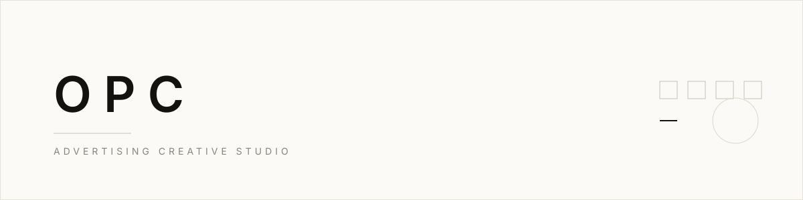

<!--
  发布前检查：
  1) 仓库名必须与 GitHub 用户名完全一致，且为 public，README.md 放在根目录
  2) 联系方式：Email 已填；微信按「不公开手机号」处理，改为邮件后提供
  3) banner 图片路径保持 ./assets/ 相对路径，不要改成外链
-->

  <picture>
    <source media="(prefers-color-scheme: dark)" srcset="./banner-dark.svg">
    
  </picture>

<h1 align="center">CREATIVE START FROM 001</h1>

一切从 001 开始 · Everything begins at 001

---

## 关于我

广告公司 Creative 001 主理人，负责方案策划、创意统筹与项目落地。习惯把一次活动拆成「策略 — 创意 — 执行 — 复盘」四段推进，再按客户所处行业调整视觉与表达的分寸。

*OPC lead at an advertising agency. I run campaigns end to end and adapt visual and verbal tone to each client's industry.*

### 职业方向 Career Direction

- 品牌活动策划与创意统筹
- 线下活动的执行管理
- 创意方案与素材体系化管理
- AI 辅助的内容生产流程搭建

### 日常工作 Daily Work

- 客户需求拆解，输出方案初稿
- 设计与影像素材的归档整理
- 行业案例的筛选与拆解
- 项目节点跟进与最终交付

### 学习计划 Learning Plan

- 创意策划方法论的系统化梳理
- AI 工具在提案与执行环节的落地
- 分行业的设计风格适配体系
- 跨行业案例库的长期积累

### 个人兴趣 Interests

- 观察线下活动的动线与体验设计
- 视觉与字体设计
- 游戏机制中的反馈设计
- 展览与空间叙事

---

## 方案管理 Solution Hub

方案与素材按四类归档。私有库不对外链接，可公开的样例整理后会在此处补充入口。

| 分类 | 收录内容 |
| :--- | :--- |
| 方案参考 Reference | 行业优秀案例的收集与拆解 |
| 方案策划 Planning | 自有客户提案的完整链路 |
| 优秀设计 Premium Design | 视觉、物料与界面设计稿 |
| 精彩策划 Standout Campaign | 落地活动的复盘与成品 |

公开样例整理中 / Public samples coming soon.

风格预设 Style presets

面向不同行业的客户，方案与视觉走不同路线：

- **游戏类** — 卡通 / 赛博科技
- **医药类** — 商务稳重 / 清新简约
- **其他** — 按活动属性与受众调整

---

## 联系方式 Contact

| 渠道 | 地址 |
| :--- | :--- |
| Email | 150103016@qq.com |
| 微信 WeChat | 邮件联系后提供 / Available upon email request |

优先通过邮件或 GitHub Issues 联系，通常 1–2 个工作日内回复。
